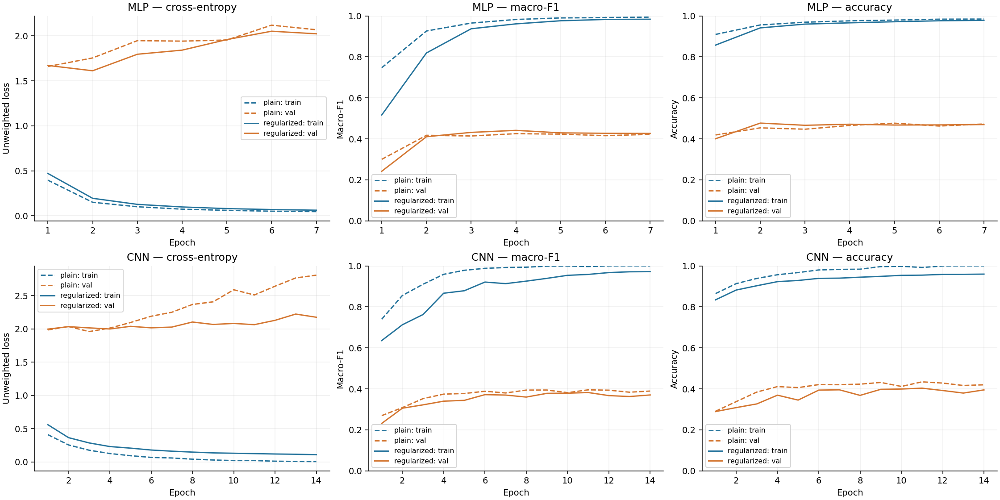
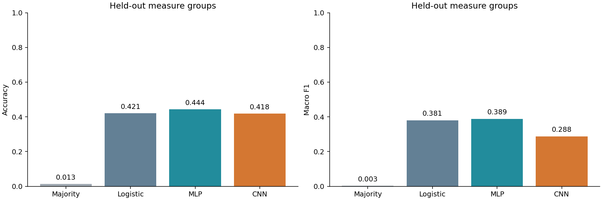
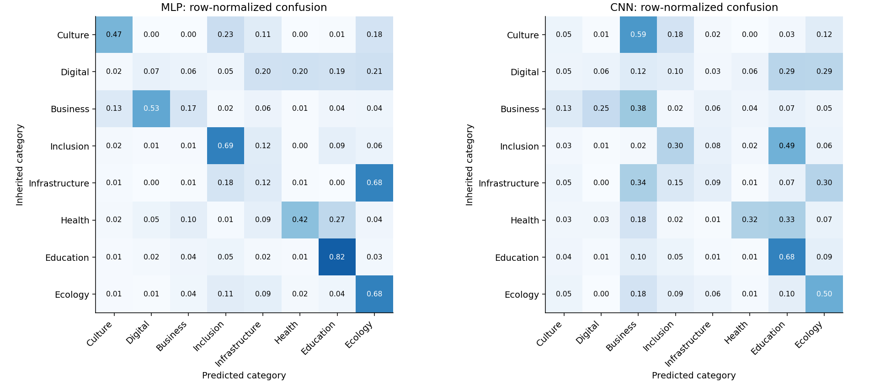
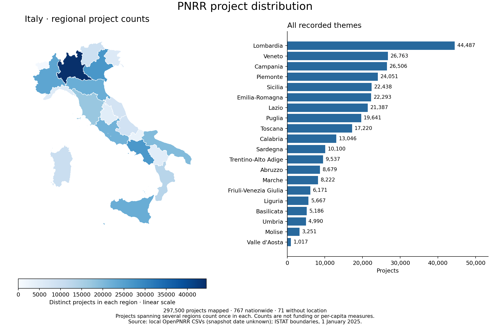
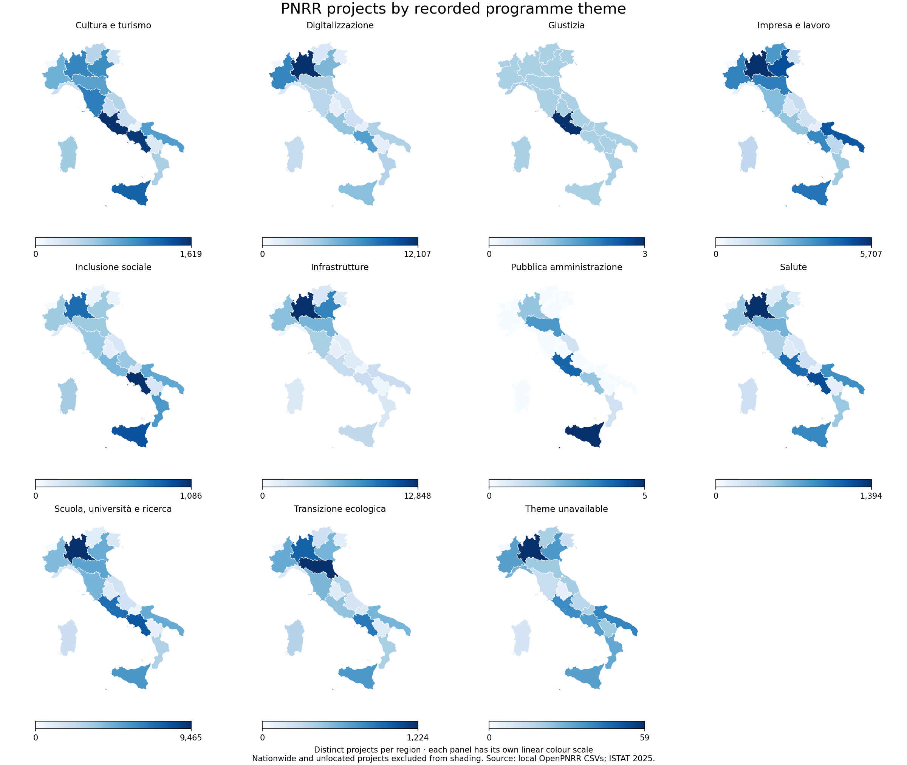

# Comparing two neural classifiers for PNRR project titles

MLP achieved the highest test macro-F1 (0.389). The stronger neural model was MLP (0.389). These values measure agreement with inherited programme themes on unseen measure groups.

## Task and evidence

The local dataset contains **298,338 projects**. The task is to predict one of eight broad themes from the Italian **project title only**, extending the existing proposal with actual experiments. Each project is joined to `misure.csv`, then its theme is traced through `temi.csv` to the root category. These are **weak labels inherited from programme metadata**, not independently reviewed purpose annotations. No target label was guessed for an unmatched join. No separate payment, location, financing, organisation, measure-description, or measure-identifier column is supplied to the models. Titles themselves can still contain organisation names or natural-language programme references.

The original proposal and input CSVs are preserved. Source SHA-256 hashes, environment versions, and seed 42 are saved in `artifacts/`. All results below are measured, not illustrative.

## Preprocessing and cleaning

Unicode is normalized, text lowercased, embedded mission/component/investment codes and digit-containing tokens removed, punctuation replaced with spaces, and whitespace collapsed. Accented Italian letters remain; stopwords remain so the CNN can learn local phrasing. Numeric removal reduces identifier shortcuts but can remove meaningful quantities. No missing titles or duplicate project IDs were found.

| Stage | Rows removed |
| --- | --- |
| Unmatched measure join | 406 |
| Fewer than three cleaned tokens | 2 |
| Normalized titles assigned conflicting root themes | 2905 |
| Repeated normalized titles (one retained) | 128444 |
| Classes with insufficient support | 60 |

Conflicting-label title strings (1,321) are excluded; identical remaining normalized titles are collapsed. Justice (6 titles) and public administration (54) do not meet the predefined support requirement of 500 unique titles and six independent groups. **166,521 unique titles** remain. This changes the estimand from all project rows to eligible unique-title examples; it must not be presented as accuracy on the entire PNRR portfolio.

## Split design and compute budget

Root measure families are joined transitively when titles or CUPs connect them. Whole connected groups go to one partition. Per-category group assignments target 60/20/20, require at least two independent groups and 20 titles per category in each partition, and ensure training is the largest partition for each category. The assignment search sees group sizes and labels only. Assertions verify no overlap of normalized titles, CUPs, measures, families, or connected groups. This is an unseen-programme evaluation, not a random-title split. Exact duplicates are controlled; lexical near-duplicates are not exhaustively detected.

| Partition | Available unique titles | Used titles | Used groups | CNN unknown-token rate |
| --- | --- | --- | --- | --- |
| train | 118,303 | 24,000 | 53 | 3.4% |
| validation | 26,999 | 8,000 | 20 | 11.5% |
| test | 21,219 | 21,219 | 24 | 15.7% |

Training and validation are stratified samples within the already separate partitions to bound CPU cost; all test titles are retained. Small groups can disappear from a sampled partition: the sampled validation set contains only one group each for culture/tourism and social inclusion, so tuning evidence for these categories is especially fragile. The complete test set still has at least two groups per class. TF–IDF, vocabulary, and class weights are fitted on the sampled training set alone. Cleaning and label-consistency checks use the dataset's metadata before splitting, not learned text statistics. The manifest records every selected ID.

| Category | Train | Validation | Test |
| --- | --- | --- | --- |
| Cultura e turismo | 1069 | 639 | 1585 |
| Digitalizzazione | 7540 | 192 | 278 |
| Impresa e lavoro | 4976 | 2369 | 8494 |
| Inclusione sociale | 818 | 542 | 1059 |
| Infrastrutture | 379 | 127 | 780 |
| Salute | 887 | 874 | 2042 |
| Scuola, università e ricerca | 7411 | 2543 | 5714 |
| Transizione ecologica | 920 | 714 | 1267 |

Perfect stratification is impossible: one connected digitalisation group holds 37,143 of 38,096 eligible digitalisation titles. It stays in training. The resulting distribution shift and sparse held-out support are limitations, not reasons to split that family across partitions.

## Model structure and training

| Model | Representation and structure | Parameters | Selected run |
| --- | --- | --- | --- |
| MLP | 6,000 word unigram/bigram TF–IDF → Dense 128 → Dense 64 → 8 logits | 776,904 | mlp_regularized |
| CNN | 12,000-token vocabulary → 64D embeddings → parallel Conv1D (64 filters, widths 3/5) → masked max pooling → Dense 64 → 8 logits | 809,672 | cnn_plain |

The MLP uses ReLU hidden layers; it learns nonlinear combinations of weighted words and bigrams but largely discards longer word order. The CNN learns embeddings from scratch, keeps local order within 3/5-token windows, pools the strongest pattern at valid token positions, and uses a ReLU hidden head. Titles are padded/truncated to 80 tokens; the saved diagnostics show the actual truncation rate. `<PAD>` has a fixed zero embedding, `<UNK>` handles unseen words, and padding positions are masked before pooling. These compact architectures suit short titles and local CPU resources; no pretrained language model or external training data is used.

Both use AdamW, initial learning rate 0.001, batch size 256, gradient clipping at norm 1, and at most 14 epochs. Cross-entropy weights are proportional to the square root of inverse training class frequency and normalized to mean one; this softens majority dominance without full inverse-frequency weighting. All neural configurations share the split, initialization seed, minibatch-order seed, optimizer, and class weights. Macro-F1 selects checkpoints because accuracy alone can hide weak minority-class predictions.

The majority baseline predicts the most frequent **training** class, digitalisation. Its small test prevalence makes this baseline particularly weak under the observed distribution shift. TF–IDF logistic regression uses balanced class weights and selects C from 0.5 and 2.0 on validation macro-F1 (selected C=2.0). The baseline's weighting differs from the neural weighting, so this is a practical pipeline comparison, not a perfectly isolated architecture experiment. Selections were frozen in `frozen_selection.json` before computing test predictions.

## Regularization, tuning, and learning curves

| Run | Best val. F1 | Best / run epochs | Final val. F1 | Time (s) | LR reductions |
| --- | --- | --- | --- | --- | --- |
| mlp_plain | 0.4254 | 4 / 7 | 0.4220 | 18.5 | 1 |
| mlp_regularized | 0.4415 | 4 / 7 | 0.4266 | 28.0 | 1 |
| cnn_plain | 0.3953 | 11 / 14 | 0.3893 | 679.2 | 1 |
| cnn_regularized | 0.3822 | 11 / 14 | 0.3703 | 409.6 | 2 |

**Dropout and weight decay:** the regularized runs use dropout 0.40 at both hidden/head sites and AdamW weight decay 0.0001. Plain runs set both to zero. Their validation macro-F1 differences are **+0.0161 for MLP** and **-0.0131 for CNN**. This is a paired *combined* ablation; it cannot attribute the difference to dropout or weight decay individually, and one seed does not establish a general advantage.

**Early stopping:** training stops after three epochs without a macro-F1 improvement greater than 0.0001, then restores the best checkpoint. Compare the best and final-epoch columns to see what restoration recovered. Patience was fixed in advance; there is no no-stopping control, so we do not claim a causal performance gain from early stopping alone.

**Learning-rate scheduling:** ReduceLROnPlateau halves the rate after two unimproved epochs. The logs show when this happened; scheduling is common to both ablation arms and is not separately isolated. Gradient clipping is an additional stability measure. Batch normalization was not added; dropout, decay, and early stopping already provide multiple regularization strategies.

Training curves evaluate a fixed stratified 3,000-title training subset with dropout disabled; validation curves use all 8,000 selected validation titles. Both plotted losses are unweighted cross-entropy in evaluation mode. The separately logged `optimization_loss` is weighted loss during minibatch training and is not directly comparable. Logs include epoch time and learning rate. The gap between training and validation performance exposes overfitting and measure shift even when training loss falls.

## Held-out comparison

| Model | Test accuracy | Test macro-F1 |
| --- | --- | --- |
| Majority | 0.0131 | 0.0032 |
| Logistic | 0.4214 | 0.3805 |
| MLP | 0.4435 | 0.3890 |
| CNN | 0.4179 | 0.2878 |

| Category | Logistic F1 | MLP F1 | CNN F1 |
| --- | --- | --- | --- |
| Cultura e turismo | 0.441 | 0.413 | 0.050 |
| Digitalizzazione | 0.005 | 0.008 | 0.013 |
| Impresa e lavoro | 0.178 | 0.270 | 0.453 |
| Inclusione sociale | 0.458 | 0.494 | 0.261 |
| Infrastrutture | 0.151 | 0.086 | 0.081 |
| Salute | 0.595 | 0.556 | 0.420 |
| Scuola, università e ricerca | 0.792 | 0.815 | 0.664 |
| Transizione ecologica | 0.424 | 0.469 | 0.361 |

## Brief evaluation and design trade-offs

MLP achieved the highest test macro-F1 (0.389). The stronger neural model was MLP (0.389). These values measure agreement with inherited programme themes on unseen measure groups. For the stronger neural model, **Scuola, università e ricerca** was the strongest class (F1 0.815) and **Digitalizzazione** the weakest (F1 0.008). Aggregate accuracy alone would conceal these differences.

What worked: inherited hierarchy labels make a reproducible supervised task possible; strict grouping prevents obvious programme memorization from inflating scores; compact networks train with available CPU resources; validation-driven regularization and checkpoint selection give a measurable comparison. The MLP is efficient because TF–IDF supplies informative lexical features immediately. The CNN can discover local phrases through learned filters, but learning its vocabulary representations from scratch costs more and is sensitive to novel language. Compare measured run times above rather than assuming deeper means better.

What did not work well: fitting training examples did not produce equally strong validation performance. New measures introduce vocabulary and purpose shifts: the CNN test unknown-token rate is 15.7%, versus 3.4% in training. A programme theme can also differ from the literal subject of a title, creating weak-label ambiguity. For example, inspected titles include photovoltaic installations under “Impresa e lavoro” and hotel digitalisation under “Cultura e turismo”. These examples illustrate the distinction; they are not a human annotation study. The proposal's macro-F1 goal of 0.80 was not met by either neural model. The observed neural advantage on this split should be checked across seeds and independently reviewed labels before preferring the more complex pipeline.

The paired group bootstrap (1,000 replicates, 24 test groups) gives MLP minus logistic macro-F1 **+0.0084**, with exploratory 95% interval **[-0.0323, +0.0422]** and one-sided 95% lower bound **-0.0249**. CNN minus MLP is **-0.1011**, interval **[-0.1777, +0.0012]**. Whole groups are resampled jointly for both models; a missing class has F1=0 in that replicate. Both reported intervals span zero, so this experiment does not establish a clear model advantage. Very few groups support some categories, so these intervals are unstable exploratory summaries, not definitive inference. The original hypothesis about independently reviewed project purposes is **not tested**, because no such gold-standard test set exists here.

The main next steps are human review of inherited labels, more independent measure groups per class, and repetition across split/initialization seeds. `label_review_sample.csv` provides examples with blank review fields; it is not claimed to be annotated. Deployment would also need probability calibration and an abstention option for unknown themes. No conclusion about funding fairness, regional performance, or future snapshots follows from these classification scores.

## Reproducibility and checks

See [README.md](README.md) for commands and [the executed notebook](02_pnrr_models_and_evaluation.ipynb) for code and outputs. Checkpoints, fitted vectorizers, source hashes, full split manifests, per-epoch CSVs, per-title test predictions, per-class metrics, and environment versions are retained. Unit checks cover cleaning, padding invariance, identity/group isolation, and preservation of the complete test partition. The original input files were not modified.

<!-- PNRR_GEOGRAPHY_START -->
## Geographic distribution of projects

[Open the interactive Italy map](pnrr_outputs/geography/italy_projects.html). Select a recorded programme theme to recolour all 20 regions; hover or tap a region for its count, or expand the regional table for exact values and theme shares.

This descriptive companion counts **all 298,338 raw project IDs**, rather than the deduplicated titles used for model training. **297,500 projects** have a regional location, **767** are nationwide only, and **71** have no location record. The highest raw counts are **Lombardia (44,487)**, **Veneto (26,763)**, **Campania (26,506)**. These counts describe the supplied OpenPNRR snapshot, whose date is unknown; they are not current live totals.

**Counting rule.** Join `progetti_territori.csv` to `progetti.csv` by project ID. Use ISTAT region codes directly for regional records and the official province-to-region lookup for municipality, province, and metropolitan-city records. Count a project once per region, removing repeated locations in the same region. All non-national location records resolve. The **806 multi-region projects** generate **300,652 project-region memberships** overall, so regional counts must not be summed as a count of unique national projects. Nationwide records are kept separate instead of being replicated over the map.

**Theme comparison.** Themes are inherited from `misure.csv` and the root hierarchy in `temi.csv`, not predicted by either model. Low-support categories are retained for this descriptive map. **406 projects** have no matched theme and remain visible under “Theme unavailable”. The table's theme share divides the selected theme's count by all mapped projects in that same region; it is not a population rate.

Each theme panel and interactive selection has its **own linear colour scale**. Compare the legends and exact counts, not colour intensity between panels. These are project counts, not funding amounts, completion rates, population-adjusted access, or evidence of regional fairness. More projects can reflect a larger region or different programme structures.

Boundaries and province-to-region attributes: [ISTAT generalized administrative boundaries, 1 January 2025](https://www.istat.it/notizia/confini-delle-unita-amministrative-a-fini-statistici-al-1-gennaio-2018-2/). Municipality-to-province mapping follows the [ISTAT code convention](https://www.istat.it/it/files/2011/01/nota-informativa.pdf). The 2025 lookup resolves every supplied code; it does not establish the project snapshot date. Source hashes and coverage checks are saved in `pnrr_outputs/geography/geography_audit.json`, and exact counts in `regional_project_counts.csv`.
<!-- PNRR_GEOGRAPHY_END -->
